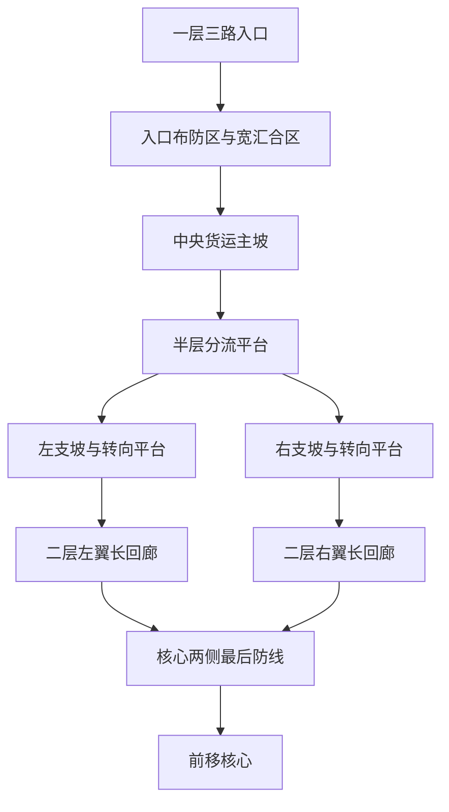

# double-layer-facility 厂房扩容与动线优化方案

日期：2026-11-18。状态：建筑扩容与几何动线已实施；怪物、陷阱运行时接入仍属后续阶段。以下设计目标及原始拟定坐标保留供对照，实际交付见文末。

## 推荐方向

主地板由 60×80 m 调整为 72×96 m，宽、长分别增加 20%，主地板面积增加 44%。二层楼面仍为 y=6.4 m，保留工业检修中心、三路入口和露天二层的辨识度。通过两翼布防带、后部转向区和二层回廊增加有效防守路段。

这些尺寸描述主地板，不包含后侧外挑检修平台；不能作为整张地图的外包尺寸。现有前立面 z=-29.5，前场约 10 m；扩容优先向两翼和后部进行。

## 当前依据

- 最新地图源 `Assets/Editor/MapSources/double-layer-facility.json` 有 635 个对象；主地板 60×80 m，三条一层通道中心 x=-20/0/20。
- 二层楼面 y=6.4 m，侧/后墙顶 y=7.6 m；玩家使用两座双跑折返楼梯。
- 后侧已有二层检修平台与额外基础，因此主地板扩容时必须同步重排后平台。
- 当前场景为 geometry-only。源中的出怪点和路径标记不等于已有怪物寻路或陷阱玩法。
- 既有 `DOUBLE_LAYER_FACILITY_RAMP_PLAN.md` 是独立的 T 形坡道提案；其横向外伸坐标不能直接套用到 72 m 宽方案。

## 扩容尺寸与边界

| 项目 | 当前 | 建议 |
| --- | --- | --- |
| 主地板 | 60×80 m | 72×96 m |
| 主地板平面边界 | x=-30…30，z=-40…40 | x=-36…36，z=-40…56 |
| 主地板面积 | 4,800 m² | 6,912 m²，增加 2,112 m² / 44% |
| 前立面 | z=-29.5 | 保留，卸货前场保留 |
| 后立面 | z=39.5 | 约 z=55.5 |
| 围合厂房进深（约数） | 70 m | 86 m；与含前场的主地板进深分别统计 |
| 二层楼面 | y=6.4 m | 保留 |
| 二层状态 | 露天 | 保留，中央坡道另留通高洞口 |

两翼各增加 6 m，后部增加 16 m。只重排受影响区域，不对整图做比例缩放：楼梯踏步、陷阱尺寸、门洞净高、柱截面和栏杆高度分别维护。后侧现有检修平台需随新后立面重新接驳，另计外挑范围；本提案不固定其最终外包尺寸。

## 一层：三路进场，形成可读的布防分区

1. 三个地面入口和主通道中心建议移到 x=-24、0、24，保留三路辨识度。未来大型怪物路线净宽统一按至少 10 m 预留；主坡前的最后收口为 12 m。
2. 两翼的新增空间优先分配给陷阱侧台、玩家检修通道和移出的服务设备。柱、货架和车间设备组织成几块完整工位，避开转弯扫掠区。
3. 入口先经过一段平直布防区，再以宽缓曲线汇入中央货运坡道。汇合区中央初步预留约 28×18 m，两侧连接还要另留扫掠范围；不得把整个转弯需求理解为只占这块矩形。
4. 布防节点采用“入口消耗区—汇合集中区—上层持续攻击区—核心最后防线”。优先延长可交战的直段，减少没有攻击角度的空跑段。
5. 坡下低净空区封闭为设备基座或检修间。设备间门口、柱脚、梁底和管线均不能吃掉道路净尺寸。

## 双层连接：将 T 形货运坡道收进新轮廓

以下是可检查的拟定坐标，用于替代旧坡道提案中外伸到 x=±39 的部分；不是已验收几何。前场在 -Z，后部在 +Z。

| 部件 | 平面净范围 | 标高与坡度 |
| --- | --- | --- |
| 中央主坡 | x=-6…6，z=0…32，净宽 12 m | y=0→5.2；投影 32 m，坡度 16.25%，约 9.2° |
| 水平分流平台 | x=-9…9，z=32…50，18×18 m | y=5.2 |
| 左支坡 | x=-17…-9，z=36…46，净宽 10 m | y=6.4→5.2（从外侧向内描述）；投影 8 m，坡度 15%，约 8.5° |
| 右支坡 | x=9…17，z=36…46，净宽 10 m | y=5.2→6.4；投影 8 m，坡度 15%，约 8.5° |
| 左转向平台 | x=-35…-17，z=32…50，18×18 m | y=6.4 |
| 右转向平台 | x=17…35，z=32…50，18×18 m | y=6.4 |
| 左右二层回廊 | 中心 x=±27，净宽 10 m | y=6.4，从后部向前返回 |

与旧提案相比，半层分流标高由 y=4.8 调整到 5.2 m，把更多高差交给中央长坡，缩短横向支坡并扩大两端转向平台。这里的 y=5.2 不是玩家楼梯的 y=3.2 中间休息平台，两套交通互不连接。

- 两侧净平台最远到 x=±35，外围约 1 m 留给结构与防护构造。平台靠边一侧的墙、柱、缘石、栏杆必须在净范围之外。
- 所列坡长为初步水平投影。坡脚和坡顶变坡段应在后续剖面设计中计入有效坡长并重算最大坡度，不能用平均坡度代替实际最大坡度。
- 两座玩家楼梯保留现有 x=±14.5、z=20…30 位置和踏步；二层怪物回廊在其外侧通过，两个洞口及玩家出口不得被封住。
- 主坡、分流平台和支坡上方留真实通高开口，拆分冲突楼板、重排柱网与主次梁，并补洞口边梁和支撑。不能把大怪通道放进现有二层楼板下面。
- 既有后检修平台保留为工业空间并重接；窄桥不计入大型怪物的主路线。

## 二层：两翼长回廊与前移核心

将核心设备基础中心从 (0,0) 调整到约 (0,-18)，仍在二层，基础暂保留 18×18 m。两条怪物路线从后部平台沿 x=±27 向前，经过长回廊后从左右进入核心区，形成“先上楼、再回绕”的完整纵深。

回廊主体从 z≈41 延伸至 z≈-18，提供约 59 m 的纵向路段。不要沿途设置通向核心后侧的怪物捷径。核心两侧的围栏、台基和进攻口要一起重做；进攻通道仍按至少 10 m 净宽预留。

回廊内侧优先放大型陷阱侧台；楼梯井、转向平台与核心接近区单独避让。回廊外侧余宽不足，不将它承诺为连续的大型陷阱带。核心前部保留玩家横向机动空间。

## 陷阱预留的计算口径

- 普通侧台以 4×6 m 为起点，大型组合侧台以 6×8 m 为起点，局部再预留 8×12 m。实际尺寸按陷阱模型与射界校核，不等于这些面积全部都能放满。
- 例如，10 m 宽道路之外若只剩 6 m 横向余量，应按约 4 m 陷阱深度与 2 m 玩家通道分配，不能同时承诺 6 m 深陷阱和额外 2 m 通道。
- 一层两条相邻主路之间约有 14 m 的横向间隔，可组织较大的侧台；中央坡道、楼梯、服务房和柱网会进一步扣减，逐块排布后再计数。
- 二层大型侧台优先放在回廊内侧，并避开楼梯井。不同区域保留地面、墙面和上方安装面的组合；露天及通高区不计入顶置陷阱安装面。
- 坡面、净通道、转弯扫掠区、坡口变坡段、玩家楼梯和出口、核心进攻口全部排除在静态占地陷阱区之外。优先用侧面和高位攻击覆盖道路。
- 新侧台不自动代表有用的攻击位置：必须检查射界、目标在攻击范围内的停留长度和上下层遮挡，避免一组陷阱在缺乏取舍的情况下覆盖多段主路线。
- 当前无可用陷阱网格，不能宣称现有槽位从某个数量增加到另一个数量。落地阶段复用项目陷阱掩码与格心换算，输出各层有效格数和可容纳的典型组合数量。

## 目标与验收

1. **可布防能力**：以同一怪物体型、道路净宽和陷阱占地规则，比较当前几何与扩容灰盒的可布防面积及典型组合容量，目标提升至少 30%。主地板面积 +44% 不等于有效陷阱容量 +44%；若不足，优先重排工位与侧台。
2. **路线长度**：中心入口到任一核心侧面进攻点，按上述拟定折线约 182 m；侧入口经宽缓汇合后初估约 190–200 m。此为几何方案估算，未做真实寻路测量，不作为延长百分比的证据。落地时按相同出发/进攻点、实际可行走表面测量新旧路线，目标增长约 30–40%；无法达到则明确报告实际结果。
3. **路线公平性**：三条地面入口的完整路线长度差初步控制在 15% 以内；分流在进入平台前决定，巨型怪不在平台内交叉换道。
4. **体型与碰撞**：沿用旧坡道提案的 8×12×4.2 m 灰盒代理，仅作为设计包络。保留顶盖的一层路线目标净空至少 4.8 m；整段验证出生、转弯、进坡、变坡、回廊和核心接近，不只检查中心线。
5. **玩家体验**：用真实 FPS 控制器往返两座楼梯，验证出口、回廊旁检修通道与核心侧向移动；保留跨层观察位置，避免中间楼板或设备完全隔绝战况。
6. **玩法接入**：当前仍为 geometry-only，尚无可运行的双层怪物路线。未来接入时先验证现有路径系统的分层与坡面能力；将玩家楼梯从所有怪物主路和追击路径中排除，避免寻路抄近路。加长地面路线不自动延长飞行怪的直达航线。

约 182 m 的计算路线为 (x,y,z)：(0,0,-37) → (0,0,0) → (0,5.2,32) → (0,5.2,41) → (9,5.2,41) → (17,6.4,41) → (27,6.4,41) → (27,6.4,-18) → (10,6.4,-18)。这是路径控制折线，不是大型代理转弯轨迹；坡道变坡和弧形转弯会改变最终长度。

## 落地顺序与文件

1. **外壳与空间骨架**：备份当前源、场景、预览后，修改 `Assets/Editor/MapSources/double-layer-facility.json` 的边界、楼板和柱网，并同步 `C:\MapForge\wwwroot\examples\double-layer-facility.json`；首个可见产物是扩容灰盒。
2. **交通闭环**：加入重算后的坡道、平台、通高洞口、核心与两翼回廊；调整 `Assets/Editor/DoubleLayerFacilityAuthoring.cs` 对应的几何生成和验证，保存前检查玩家与大型代理通行。现有玩家楼梯碰撞补充继续由生成器维护。
3. **布防能力**：搬移冲突工位，逐块标出有效陷阱侧台、攻击方向和玩家通道，统计格数与组合容量；不靠增加装饰对象数量表达扩容收益。
4. **预览与玩法后续**：重建 `Assets/Scenes/DOUBLE_LAYER_FACILITY.unity`，提供总览、上下层俯视、纵剖面、坡道出口与玩家视角预览；怪物与陷阱运行时接入单独推进，不把几何验证当作战斗验证。

备份、预览与一次性验证产物放在 `C:\Users\ASUS\Desktop\陷阱素材文件夹\DoubleLayerFacility\` 的本轮子目录。每一步控制在约 15 分钟内，并以文件修改和简短 diff 摘要结束；需要多轮时继续拆分。测试专用源码放项目外或 `Tests~`，结束后不得留在 Unity 导入目录。

## 本轮交付状态

已修改地图源、生成器并重建场景，同步 MapForge 示例；保留原 T 形坡道提案供对照。实际主地板 72×96 m、二层标高 6.4 m、核心中心 (0,-18)，中央主坡、分流平台、两条支坡、两翼回廊和后检修平台均已落地。

落地调整：地面出生中心前移到 z=-33，让长 12 m 的代理全足迹位于前场内；主坡两端各 2 m、支坡两端各 1 m 使用变坡过渡。前排设备移到外侧，核心进攻通道不放布防区；最终一层 4 块 6×8 m、二层 4 块 6×8 m 和 2 块 6×4 m 预留区，总计 432 m²，避免布防空间与道路重复计数。

Unity `DoubleLayerFacilityAuthoring.BuildAndPreview` 已通过保存前与重载后检查：两座楼梯实际 FPS 胶囊往返、露天检查、主地板尺寸、10 块预留区障碍与支撑、8×12×4.2 m 代理加 .6 m 净空的六条货运几何扫掠。实际源节点折线长度 177.53…193.66 m，入口长度差约 9.1%；不把该值当作真实 AI 寻路长度或相对旧图增幅。旧图同口径路长、运行时陷阱容量 +30% 目标尚未验证。

最终 1,124 个源对象；11 张预览及最终日志位于 `C:\Users\ASUS\Desktop\陷阱素材文件夹\DoubleLayerFacility\`。总览、上下层、坡道、分流和剖面已目视检查。当前仍为 geometry-only 场景，未做人工 PlayMode、真实怪物/动画验证或完整 Player 构建。扩容前备份位于该目录的 `expansion-backup\20261118-005843\`。
